# Kuro Inventory Pricing — Estudo de caso: precificação e estoque com IA local, em um executável que se atualiza sozinho e não confia em ninguém

> **O código completo é fechado.** Este repositório é documentação pública de arquitetura e de decisões de engenharia, mais trechos isolados e executáveis em `amostras/`. Os nomes de arquivos, testes e scripts citados (`logg.md`, `scripts/*`, `tests/*`, `D-0xx`) pertencem ao repositório privado. Se você está avaliando meu trabalho e quer ver mais, é só pedir: berlofaspike@gmail.com.

> Mini-SaaS **single-tenant** (um `.exe` e um banco local por cliente) de precificação inteligente e controle de estoque, com **LLaMA 3.1 8B rodando local** via Ollama. Estado documentado: **2026-10-09** (Fases 0 a 6). Os números foram **medidos**; a seção 7 diz o que **não** foi provado e a seção 6 lista os erros que meus próprios testes acharam.


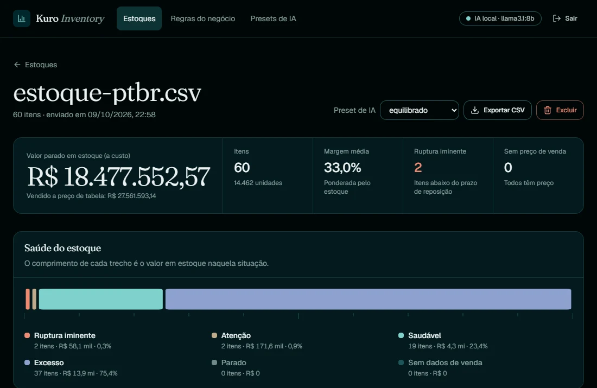

*Painel real do executável, com dados sintéticos de 60 itens. Todas as imagens deste documento foram capturadas por Chrome headless, só da página do app em execução (e do HTML do relatório de e-mail), nunca da tela do computador.*

**Neste documento:** [Resumo](#resumo-em-uma-tela) · [1 Problema](#1-o-problema) · [2 Visão geral](#2-visão-geral) · [3 Decisões técnicas](#3-decisões-técnicas-profundas) · [4 Verificação](#4-como-foi-verificado) · [5 Resultados](#5-resultados-medidos) · [6 Erros meus](#6-erros-que-os-meus-próprios-testes-acharam) · [7 Não provado](#7-o-que-não-está-provado) · [8 Alternativas](#8-alternativas-que-descartei) · [9 Repetir](#9-como-repetir)

---

## Resumo em uma tela

| Pergunta | Decisão | Evidência (medida) |
|---|---|---|
| Como usar IA sem o dado do negócio sair da máquina? | cliente de IA **só aceita host local**, sem proxy do ambiente e sem redirecionamento; é propriedade testada, não promessa | recusa host externo, IP de rede, credenciais, caminho e esquema (exercitado nos trechos de `amostras/`) |
| Como confiar num modelo de 8B para decidir preço? | **o LLM propõe, o código valida**: o modelo só pede um ajuste de ±30%; a conta e o piso/teto de margem são funções puras | 20 mil casos aleatórios (seed fixa): **0** preços fora de `[piso, teto]`; com preço absoluto o guarda-corpo cortou **10/20** |
| O que fazer com uma planilha que ninguém padronizou? | tudo entra como texto, perfil vetorizado por coluna, mapeamento proposto e **confirmado por humano**, linhas ruins vão para uma DLQ com motivo | **5/5** variantes de formato mapeadas e ingeridas como o gabarito |
| E a memória com planilhas grandes? | **tetos duros** (25 MB, 200 mil linhas, 200 colunas), perfil sobre amostra de até 20 mil linhas, **sem arquivo temporário em claro** | 200 mil linhas em **5,5 s**, pico de **580 MB** (≈ 2,5 KB/linha: cresce com o arquivo; seção 3.3) |
| Como proteger o dado parado em disco? | Fernet obrigatório, blob **amarrado ao id do registro**, chaves protegidas por DPAPI | nome do arquivo, SKU e categorias **não aparecem** no SQLite nem no `-wal`; blob copiado para outra linha é recusado |
| Como entregar a quem não tem Python? | PyInstaller `--onefile` com o React dentro + **PyArmor** sobre uma cópia de preparo | nomes legíveis no PYZ: **267/267 → 0/267**; docstrings **128/128 → 0/128**; exe ≈ 78 MiB, partida ≈ 4 s |
| Como atualizar o cliente sem abrir porta e sem confiar no servidor de download? | OTA **pull** com manifesto **assinado com Ed25519** (versão, hash, tamanho, data e URL), só versão maior, apaga tudo ao menor desvio | E2E real com 2 `.exe`, HTTPS local e 4 cenários de ataque; mutação **43/43** |
| Como garantir que o cliente nunca receba código administrativo? | variante `"cliente"` **gravada na compilação** e verificação que falha o build se sobrar rastro | 10 chunks JS, **0** rastros; o `.exe` recusa o modo administrativo mesmo com variável de ambiente |
| O texto do modelo é confiável? | **não**, e a arquitetura assume isso: o texto é exibido, nunca decide | 14 resumos distintos em 20 itens; recomendou "aumentar estoque" para itens com centenas de dias de cobertura |
| Os testes pegam defeito de verdade? | teste de mutação sobre as regras críticas, fuzz com seed fixa, Chrome real | **488** testes no backend, mutação **43/43** (+ **4/4** no front), **26** verificações em Chrome real |

**Em duas frases:** o modelo é tratado como um estagiário rápido e não confiável: tudo que entra nele é dado, tudo que sai dele é dado hostil, e nenhuma decisão de dinheiro ou de instalação passa por ele. O restante (cripto em repouso, empacotamento, atualização) segue a mesma regra: **falha fechada, limite duro, prova por teste**.

---

## 1. O problema

O público é o pequeno comércio e a pequena indústria que mantêm estoque e preço em planilhas. A dor tem cinco camadas, e cada uma virou um requisito de engenharia:

| # | Dor | Por que importa | Requisito derivado |
|---|---|---|---|
| 1 | **Cada planilha é diferente.** "Custo", "Preço de compra", "Valor unit.", "cost". | Colunas fixas obrigam o cliente a reformatar tudo, e quem reformata erra. | ingestão **agnóstica**, com mapeamento proposto e conferido |
| 2 | **Mapear errado é silencioso.** | Trocar custo por preço de venda não gera erro: gera margem errada e confiante. | **confirmação humana** obrigatória; nada é importado antes |
| 3 | **Ruptura e excesso são tratados tarde.** | Sem cobertura em dias comparada ao prazo de reposição, a ruptura aparece só quando a prateleira esvazia. | indicadores (ABC, cobertura, saúde) como **funções puras** |
| 4 | **IA na nuvem é barreira de confiança.** | Estoque, custo e margem são o coração competitivo do negócio. | IA **local**; dado nunca sai por padrão |
| 5 | **Software instalado vira problema de manutenção.** | Se o produto roda na máquina do cliente, ele precisa se atualizar sem que o canal de atualização vire a porta de entrada do atacante. | OTA **assinado**, pull, sem porta aberta |

### Por que Zero-Trust, e não "boas práticas"

Em um produto on-premise, o atacante não está "fora da rede": ele **é** a planilha, o texto que a IA devolve, o servidor que hospeda o download e, às vezes, o próprio usuário local. Modelei isso explicitamente:

| Ativo | Adversário / vetor | Controle | Onde está |
|---|---|---|---|
| Dado do negócio | host de IA trocado por configuração, proxy do ambiente, redirecionamento | host travado em localhost, `trust_env=False`, `follow_redirects=False` | 3.1 |
| Decisão de preço | célula com instrução escondida (prompt injection), saída do modelo com valor inventado | dado embrulhado e escapado, saída validada item a item, guarda-corpo de margem | 3.1, 3.2 |
| Memória e disco da máquina | planilha enorme, zip bomb, macro, arquivo que não é planilha | validação de upload, tetos duros, corpo cru | 3.3, 3.5 |
| Banco em repouso | cópia do arquivo `.db`, troca de blobs entre linhas | Fernet obrigatório + contexto no blob + DPAPI | 3.4 |
| Código do produto | engenharia reversa básica do `.exe` | ofuscação (atrito, não segredo) + variante gravada na compilação | 3.6 |
| Canal de atualização | servidor de download comprometido, MITM, replay de release antigo, download infinito | Ed25519 + hash + tamanho + URL assinados, anti-downgrade, teto, apaga ao desvio | 3.7 |
| Saída de dados | exfiltração "legítima" pelo relatório por e-mail | opt-in com duplo consentimento, TLS verificado, só consolidado | 3.8 |

Requisitos que moldaram tudo: privacidade por padrão, nenhuma conta de IA em nuvem, um único artefato instalável, atualização segura sem servidor empurrando nada para dentro da máquina do cliente, e **cada garantia precisa ter um teste que falhe se ela for quebrada**.

---

## 2. Visão geral

### 2.1 Componentes

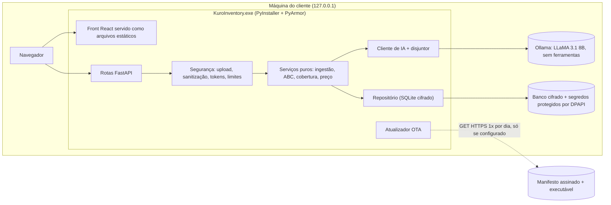

- **Single-tenant de propósito.** Um executável e um banco por cliente: não existe consulta que possa vazar dado entre clientes, porque não existe "entre clientes".
- **Repository Pattern com `Protocol`.** Memória e SQLite hoje; PostgreSQL previsto trocando uma variável. A suíte de contrato roda nos dois primeiros; **PostgreSQL nunca foi executado** (seção 7).
- **Front em FSD** verificado por linter de arquitetura; gráficos em SVG próprio (sem biblioteca) e animações só em CSS.
- **O backend serve o front compilado** só em `127.0.0.1`, com CSP própria da página e CSP fechada (`default-src 'none'`) na API, e filtro de `Host` contra DNS rebinding.

### 2.2 Do upload ao preço

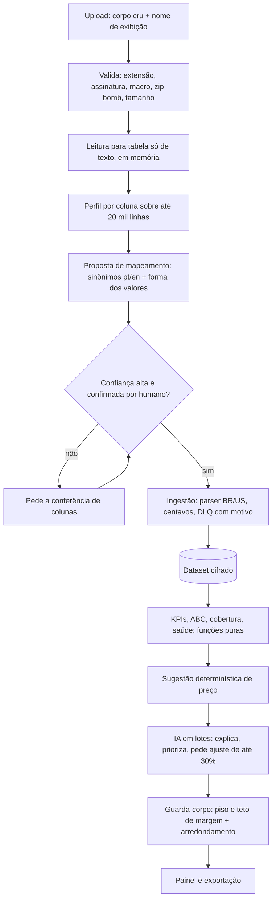

### 2.3 A tela

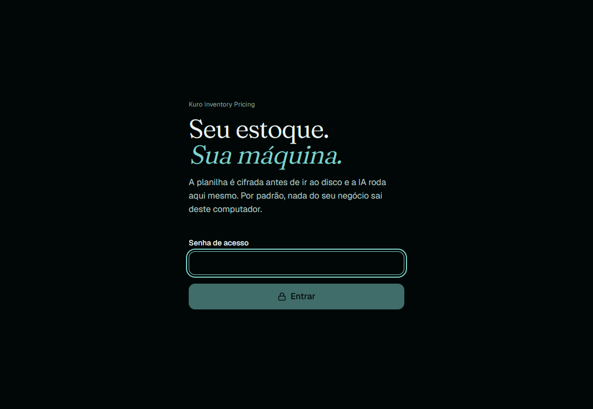

*Tela de entrada. O texto não é decoração: "por padrão, nada do seu negócio sai deste computador" é o contrato que o resto do documento prova.*

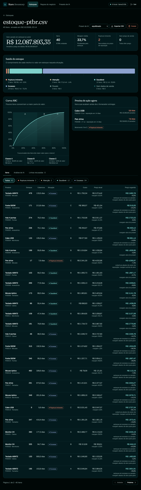

*Painel completo com 60 itens sintéticos: KPIs, saúde do estoque, curva ABC e ruptura iminente, tudo em SVG próprio e calculado por funções puras, sem a IA.*

---

## 3. Decisões técnicas profundas

### 3.1 Zero-Trust com LLaMA 3.1 8B local

Cinco camadas, cada uma com teste próprio. Trechos em `amostras/ia_*.py`.

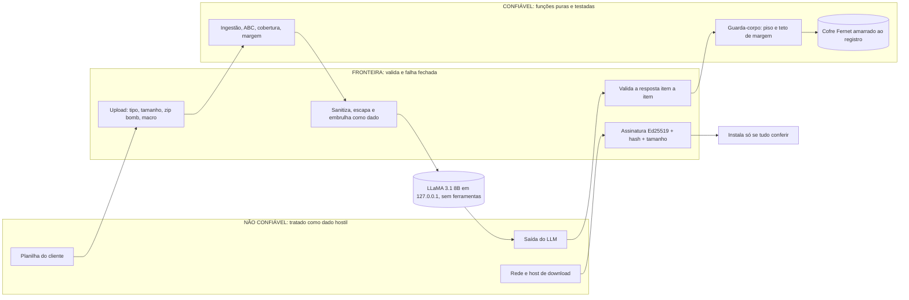

*As três zonas. O modelo fica no meio de duas fronteiras: o que entra nele é dado, o que sai dele é dado hostil, e a decisão de dinheiro só existe depois do guarda-corpo.*

#### 3.1.1 O host da IA é uma propriedade verificável

A URL do Ollama é validada na configuração **e de novo no construtor do cliente**: só `localhost`, `127.0.0.1` ou `::1`, sem usuário/senha, sem caminho, query ou fragmento. O `httpx.Client` sobe com `trust_env=False` (ignora `HTTP(S)_PROXY` do ambiente, que poderia mandar o tráfego para um proxy corporativo) e `follow_redirects=False` (um 30x para fora da máquina seria vazamento). Alternativa descartada: aceitar qualquer URL, como no meu projeto anterior (Kuro Core): barato, mas "o dado não sai" deixa de ser verificável.

Semântica de erro: 4xx **não repete** (requisição errada não melhora com insistência); 5xx, timeout e conexão repetem com backoff exponencial (até 3 tentativas, esperando 1 s e depois 2 s). `format=json`, `num_ctx=8192` e `num_predict=3000` (sem teto, o modo JSON pode gerar sem fim).

→ `amostras/ia_cliente_local.py`

#### 3.1.2 Dado de planilha é dado, nunca instrução

Toda célula que vai ao prompt passa por quatro transformações, nesta ordem:

1. **Sanitização**: e-mail, CPF/CNPJ, telefone e `chave=valor` com cara de segredo viram marcadores (`[EMAIL]`, `[SEGREDO]`...). É a *segunda* linha de defesa: a primeira é mandar ao modelo só o necessário, e ele é local.
2. **Limpeza de controle**: remove caracteres de controle e de direção invisíveis (usados para esconder instrução em texto aparentemente inocente).
3. **Escape**: `<` e `>` neutralizados, para o dado não fechar a tag que o envolve.
4. **Embrulho**: `<dados origem=...>...</dados>`, com o prompt de sistema dizendo explicitamente que o conteúdo da tag nunca é ordem.

O modelo **não recebe ferramenta nenhuma**: só devolve JSON. Os itens vão **numerados** e o modelo responde pelo número, então o SKU nunca precisa voltar pela boca do modelo (sem SKU alucinado, sem injeção por SKU).

→ `amostras/ia_entrada_saida_hostil.py`

#### 3.1.3 A saída do modelo é dado hostil

Cada resposta é validada **item por item**: `n` inteiro dentro do lote e não repetido, `risco` de um conjunto fechado, textos com tamanho máximo e sem caracteres de controle, ajuste dentro de ±30%. Frases do texto livre com `$` são descartadas (o modelo inventava preço no resumo); se não sobra frase, o item cai. Item inválido é descartado; o **lote só falha se nada aproveitável sobrar**.

#### 3.1.4 O LLM propõe, o código valida

| Responsabilidade | Quem faz | Por quê |
|---|---|---|
| Conta (ABC, cobertura, margem, arredondamento) | código, funções puras | determinístico e testável; modelo de 8B erra aritmética |
| Classificar coluna ambígua | LLM local, com schema | interpretação de linguagem é o ponto forte do modelo |
| Explicar risco e priorizar itens | LLM local, em lotes | texto útil para humano, com os números já calculados |
| **Preço final** | **regra de negócio** | o preço do LLM é uma proposta, limitada por piso e teto |

O desenho do preço foi **mudado depois de medir**:

| Desenho | Resultado medido (`llama3.1:8b`, 20 itens, lotes de 10) |
|---|---|
| Modelo devolve o **preço absoluto** | errou a escala (devolveu 420 para referência de R$ 2.754,48); guarda-corpo cortou **10 de 20**; escreveu preços inventados no resumo |
| Modelo pede **ajuste percentual** sobre um preço já calculado | **14/20** itens com ajuste pedido, ajustes entre −15% e +10%, **0 cortados** (uma execução); outra execução cortou 1/20 |

```python
proposto = referencia * (10_000 + ajuste_bps) // 10_000
preco, cortado = finalizar_preco(proposto, custo, regras)   # limita a [piso, teto], depois arredonda para cima
```

→ `amostras/ia_guarda_corpo_preco.py`

#### 3.1.5 Disjuntor: IA fora do ar não derruba o produto

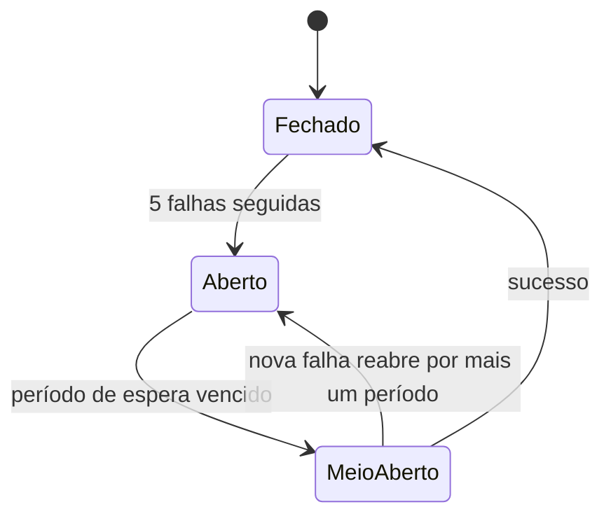

Aberto, o lote **nem toca na rede**; meio-aberto deixa passar **uma** tentativa. Servidor fora do ar interrompe a camada de IA, mas KPIs, curva ABC e preço determinístico continuam. Lotes de tamanho fixo mantêm tempo e memória por chamada independentes do tamanho da planilha, e a IA é gasta onde importa: ruptura e encalhe primeiro, depois os de maior valor. Um bug que meus testes acharam aqui: o laço chamava `falha()` mesmo com o disjuntor já aberto, prolongando o bloqueio sem motivo (seção 6).

→ `amostras/ia_disjuntor.py`

**Como isso aparece na tela** (LLaMA 3.1 8B real, rodando local, 40 itens sintéticos em 2 lotes):

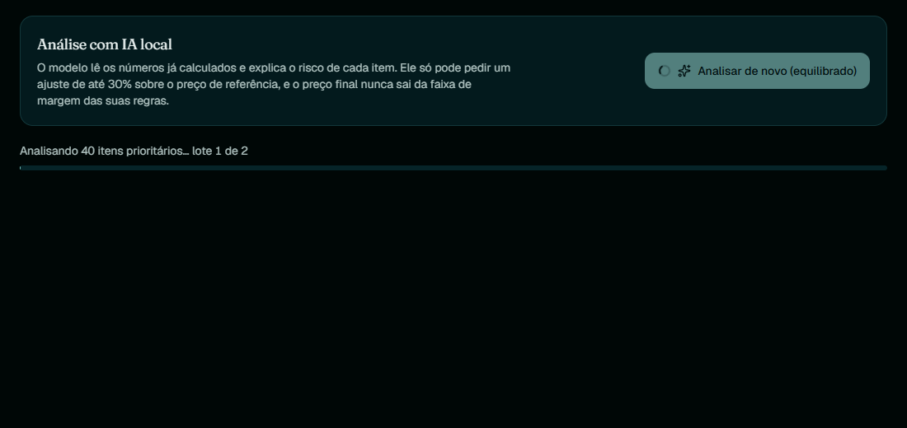

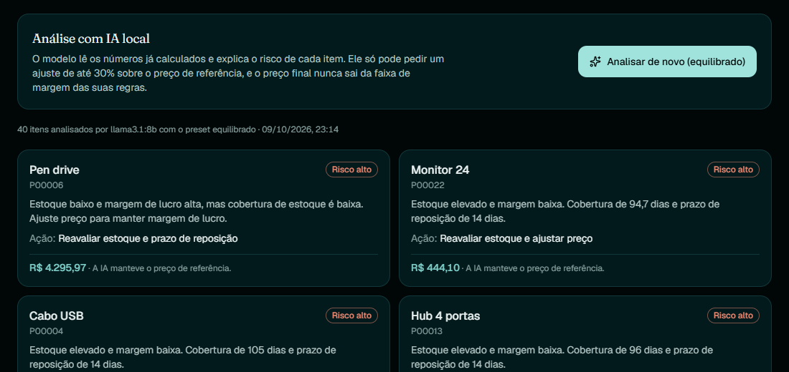

*Cada cartão mostra o preço **depois** do guarda-corpo e diz o que a IA fez com ele ("A IA pediu +X% sobre o preço de referência" ou "A IA manteve o preço de referência"). O texto do modelo é genérico e às vezes repetitivo: é a limitação documentada na seção 7, e é por isso que ele nunca decide preço.*

### 3.2 Dinheiro e margem: a conta que não pode errar

- **Dinheiro em centavos inteiros e margem em pontos-base** (3000 = 30%). Nada de `float` em lugar nenhum: o texto vira `Decimal` exato e depois inteiro (`ROUND_HALF_UP`).
- **Margem sobre o preço de venda**, não markup sobre o custo. A definição está escrita porque a confusão entre as duas é a fonte clássica de preço errado:

```
preço = ceil( custo × 10 000 / (10 000 − margem_bps) )        margem = (preço − custo) / preço
```

  O `ceil` (teto da divisão inteira) garante que o preço entrega **pelo menos** a margem pedida; um `floor` entregaria menos que o mínimo em casos de borda.
- **Faixa permitida**: `piso = preço(custo, margem_mínima)` e `teto = ⌊custo × 10 000 / (10 000 − margem_máxima)⌋`, com `teto ≥ piso`.
- **Arredondamento sempre para cima** (`inteiro`, `terminado_90`): arredondar para baixo poderia furar a margem mínima. Se o arredondamento passar do teto, vale o preço sem arredondar.
- **Presets** (conservador, equilibrado, agressivo) são dados validados; mudam posição-base na faixa, aumento em ruptura e desconto em excesso. O preço do excesso do "agressivo" estava maior que o do "conservador" (preset mal desenhado, achado por teste) e foi redesenhado.
- **Limites de sanidade**: valor monetário acima de R$ 10 bilhões é recusado como erro de digitação ou ataque; número com 500 dígitos vira erro de validação, não `InvalidOperation`.

→ `amostras/dinheiro_centavos.py`

### 3.3 Polars, o teto de 25 MB e o pico de 580 MB

#### O que o Polars faz aqui, e o que não faz

- **Contêiner colunar de texto.** A planilha vira um `DataFrame` com schema `String` fixo: sem inferência de tipo (que erraria em silêncio, p. ex. `00123` virando `123`), e coluna a coluna, bem mais compacto que uma lista de dicionários.
- **Perfil vetorizado sobre uma amostra de até 20 mil linhas.** Taxas de vazio, inteiro, numérico, percentual e unicidade saem de expressões (`str.contains`, `n_unique`) sem laço Python por célula; o custo do perfil **para de crescer** a partir de 20 mil linhas.
- **Leitura de `.xlsx`** pelo motor `calamine` (Rust, via `fastexcel`), com `infer_schema_length=0`. Escolhi isso em vez de `openpyxl` porque o leitor em Rust lê a planilha sem executar nada (D-012).

**O que ele não faz**, e que a medição mostrou: **não torna a memória constante.** O CSV é lido pelo módulo `csv` da biblioteca padrão (preciso detectar campos além do cabeçalho e transcodificar cp1252 com decisão por linha), e a ingestão itera linha a linha em Python.

#### A medição

| Linhas | Tamanho | Total (validar + ler + mapear + ingerir + indicadores) | Pico de memória do processo |
|---|---|---|---|
| 1.000 | < 0,1 MB | 0,04 s | 65 MB |
| 20.000 | 0,8 MB | 0,52 s | 118 MB |
| 200.000 | 8,2 MB | 5,51 s | **580 MB** |

A memória cresce ≈ **2,5 KB por linha** (`(580 − 65) MB / ~199 mil linhas`). O 8,2 MB do arquivo de 200 mil linhas fica **abaixo** do teto de 25 MB: os dois tetos (bytes e linhas) existem porque protegem coisas diferentes (arquivo largo e curto × arquivo estreito e longo).

#### Por que aceitei isso (D-011)

A alternativa era escrever intermediários em Parquet em disco e processar em streaming, como faço no Kuro Core (memória constante). Mas **arquivo temporário em claro contradiz a criptografia em repouso obrigatória**. A troca consciente: memória proporcional ao teto em vez de constante, ganhando "nenhum byte do cliente toca o disco sem cifra". A proteção contra estourar a máquina é o **teto duro**:

| Teto | Valor | Protege contra |
|---|---|---|
| bytes do upload | 25 MB | arquivo gigante |
| linhas | 200 mil | arquivo longo e estreito |
| colunas | 200 | arquivo largo (explode o perfil e o mapeamento) |
| descompactado (`.xlsx`) | 200 MB | zip bomb |

Dentro dele, o pior caso medido é 580 MB. Planilha acima do teto é **recusada com mensagem**, não processada pela metade.

**Pontos de dor reais**, para não parecer que está resolvido: o `Dataset` inteiro é **recifrado a cada `salvar`** (inclui a lista de itens), aceitável até algumas dezenas de milhares de itens e **não medido** acima disso; a gravação cifrada de 200 mil itens e o dashboard sobre ele não foram medidos. Se o requisito fosse 5 milhões de linhas, o caminho seria o streaming em Parquet **cifrado por bloco**, e isso seria outro projeto.

→ `amostras/ingestao_polars.py`

### 3.4 Ingestão agnóstica

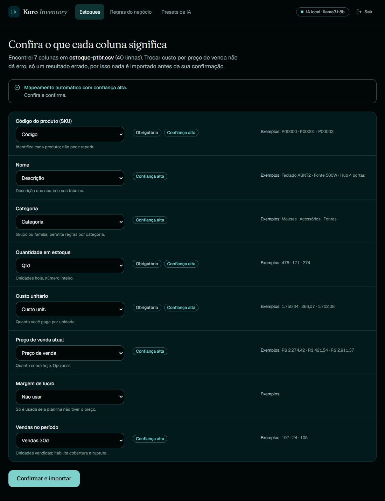

*A conferência de colunas. Planilha em pt-BR (`;`, cp1252, `R$`) reconhecida sozinha, mas **nada é importado antes de o humano confirmar**: trocar custo por preço de venda não dá erro, só um resultado errado.*

1. **Validação do upload** sem executar nada: extensão, assinatura de arquivo, `.xlsx` com macro, caminho suspeito dentro do zip ou planilha protegida por senha são recusados; soma do tamanho descompactado limitada.
2. **Leitura para tabela só de texto**: UTF-8 (com ou sem BOM), UTF-16 ou cp1252; separador detectado (`, ; tab |`); nomes de coluna deduplicados.
3. **Mapeamento**: nota por nome (sinônimos exatos 1,0; contém 0,6–0,8; contido 0,45) e por valores (SKU precisa ser único; custo e preço, numéricos; categoria, repetida e não numérica). Confiança = `0,65·nome + 0,35·valores`; **só pelos valores nunca passa de 0,21**, então sempre pede confirmação. A IA entra só nas ambíguas e **nunca é auto-confirmada**.
4. **Ingestão com DLQ**: nenhuma linha some em silêncio. Cada recusa tem uma frase fixa de motivo (nunca o valor da célula, então pode ir para log), número da linha **como o usuário a vê no Excel** (cabeçalho = 1), valor original truncado em 80 caracteres e no máximo 1.000 linhas guardadas (o total é contado).
5. **Parser de número bilíngue**: `1.234,56`, `1,234.56`, `R$ 12`, `30%`, `0,3` (fração abaixo de 1). `1.234` é milhar BR; `1,234` é decimal BR.

### 3.5 Upload como corpo cru e superfície HTTP

- **Corpo cru** (`application/octet-stream` + cabeçalho `X-Nome-Arquivo`), não `multipart/form-data`: o framework grava upload grande num arquivo temporário **em claro**, o que contradiz D-008/D-011. Um teste prova o `413` **com e sem** `Content-Length` (o limite conta bytes de corpo chunked).
- O nome vindo do cliente **nunca** é usado como caminho: o arquivo vive no banco, cifrado; o nome serve só para exibição, normalizado.
- Sessão por token HMAC-SHA256 com expiração, verificado com `compare_digest`; senha em `scrypt`; resposta de falha **uniforme** (não diz o que falhou); limite de taxa por IP.
- Cabeçalhos de segurança (`nosniff`, `no-store`, sem `Server`); `/docs` desligado; CORS por lista (`*` é recusado na configuração); bind em `127.0.0.1`.
- **Exportação CSV com neutralização de fórmula**: célula que começa com `= + - @` vira texto literal (CSV/Excel injection).

### 3.6 Criptografia em repouso e contexto amarrado

Fernet (AES-128-CBC + HMAC-SHA256) com `MultiFernet` para rotação. A cifra é **por agregado** (um blob por dataset/regra/preset); em claro ficam só `id`, `criado_em` e `status`. Cada blob carrega o **contexto** (o id da linha) dentro do texto cifrado, conferido na leitura com `compare_digest`: **um blob copiado para outra linha do banco é recusado, mesmo com a chave certa**.

| Verificação | Resultado |
|---|---|
| Arquivo SQLite de 168.736 bytes (incluindo `-wal`) | `P00001`, o nome do arquivo e `Cabos` **não aparecem em claro** |
| Blob de uma linha colado em outra | recusado (`ErroSeguranca`) |
| Sem chave de criptografia válida | a aplicação **não sobe** (D-008) |

Custo assumido: não dá para filtrar por SKU no SQL (os indicadores são calculados em memória). Consequência assumida: **perder a chave é perder os dados**; o backup é de quem opera. No executável, as chaves ficam num pacote protegido por **DPAPI** (via `ctypes`, sem dependência nova), amarrado à conta do Windows: copiar a pasta para outra conta ou máquina não decifra nada. Limite honesto: quem controla a conta do Windows abre tudo.

→ `amostras/cofre_contexto.py`

### 3.7 Empacotamento: PyInstaller + PyArmor, e o que 267/267 significa

```mermaid
flowchart LR
  A["Front sem a flag de administração"] --> B["verifica:sem-admin"]
  B --> C["Cópia de preparo do backend"]
  C --> D["Grava VARIANTE = cliente"]
  D --> E["Embute a chave pública do OTA"]
  E --> F["Coleta imports de terceiros por AST"]
  F --> G["PyArmor sobre a cópia"]
  G --> H["PyInstaller onefile + front + ícone"]
  H --> I["KuroInventory.exe"]
```

1. **Build do front sem a flag de administração** e uma verificação que **falha o build** se algum rastro de código administrativo estiver no bundle (10 chunks JS, 0 rastros). Houve um erro aqui: o primeiro build do cliente **ainda carregava o painel**, porque a flag estava num módulo separado e o `import()` não era eliminado; só ao inlinar `import.meta.env` no ponto do `import()` o chunk sumiu. Foi a verificação, não a revisão, que achou.
2. **Cópia de preparo** com a variante `"cliente"` **gravada na compilação**. O `.exe` recusa o modo administrativo mesmo que alguém defina a variável de ambiente: não é configuração, é o que foi compilado. O repositório continua com a linha vazia.
3. **Chave pública do OTA** embutida só na cópia de preparo (nunca no repositório); o build **recusa** arquivo que pareça chave privada e chave malformada. Sem chave embutida o executável **recusa qualquer atualização** (falha fechada).
4. **Imports de terceiros coletados por AST antes da ofuscação.** O código ofuscado esconde os `import` do PyInstaller; sem isso o executável compilaria e quebraria na primeira execução com `ModuleNotFoundError`. Também é preciso coletar submódulos importados por texto (`uvicorn`, `sqlalchemy.dialects.sqlite`, `polars`, `fastexcel`).
5. **PyArmor, não Cython**: Cython exigiria compilador C, que não havia na máquina de build.
6. **PyInstaller `--onefile`** com o front como dado embutido.

#### O que "267/267 → 0/267" mede, e o que não mede

Auditei o arquivo **PYZ** do executável (onde o PyInstaller guarda o bytecode):

| Métrica | Sem ofuscação | Com PyArmor |
|---|---|---|
| Nomes de função/classe legíveis | **267/267** | **0/267** |
| Docstrings legíveis | **128/128** | **0/128** |
| Tamanho | 77,7 MiB | 78,2 MiB |
| Build | 72 s | 65–83 s |
| Partida a frio até `/api/saude` | ≈ 3,7–4,3 s | ≈ 3,7–4,3 s |

**A armadilha da medição:** a busca por nomes nos **bytes brutos** do `.exe` dá 0/267 *nos dois builds*, porque o PKG é comprimido. Essa checagem não distingue nada e daria falsa sensação de segurança; por isso a auditoria foi feita no PYZ. `--onefile` extrai ~80 MB a cada partida: é o custo do artefato único.

**Tratamento honesto:** ofuscação é **atrito contra engenharia reversa básica, não segredo**. Quem executa o programa observa o comportamento; nada impede análise dinâmica. A segurança real de licenciamento é validação no servidor, não o `.exe`, e essa validação remota **ainda não existe** (seção 7).

→ `amostras/empacotamento_pyarmor.py`

### 3.8 OTA pull-based com Ed25519

**Premissa:** o canal de atualização é o alvo mais valioso do produto. Quem assina uma atualização executa código na máquina de todos os clientes. O desenho assume que **o servidor de download pode ser comprometido** e que o transporte pode ser interceptado: a única coisa em que o cliente confia é uma chave pública de 32 bytes gravada na compilação.

#### 3.8.1 Pull, não push

| Critério | Servidor que empurra (push) | Cliente que consulta (pull) — **escolhido** |
|---|---|---|
| Superfície de entrada na máquina do cliente | porta aberta ou agente persistente | **nenhuma**: só uma conexão de saída |
| O que o servidor precisa saber | quem são os clientes e onde estão | nada: serve um arquivo estático |
| Telemetria | quase inevitável | **nenhuma**: nada além do `GET` (sem ID, sem versão) |
| Custo de operação | servidor com estado | qualquer host estático (Pages, Releases, S3) |
| Revogação | rápida | lenta (próxima checagem) |
| Falha do servidor | clientes sem atualização e sem alerta | cliente continua funcionando e tenta de novo |

A checagem é **diária, com atraso aleatório inicial**, só se `KURO_OTA_URL` existir (sem valor padrão = desligado), e cada redirecionamento também precisa ser HTTPS.

#### 3.8.2 O fluxo, em ordem de desconfiança crescente

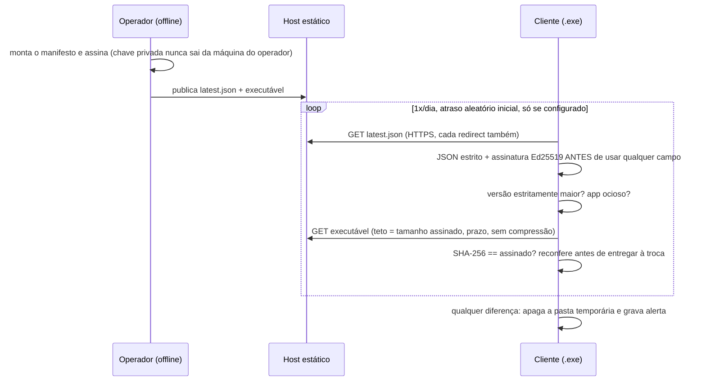

#### 3.8.3 O fluxo criptográfico, campo a campo

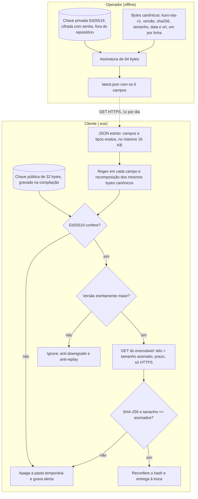

*A chave privada nunca chega ao cliente e a pública nunca sai do executável. Um servidor de download comprometido não consegue fazer o cliente **instalar** nada: para isso precisaria assinar. No máximo consegue impedir ou atrasar a atualização (ataque de congelamento, seção 7).*

#### 3.8.4 Decisões, uma a uma

| Decisão | Por quê |
|---|---|
| **Ed25519**, não RSA nem "só hash" | chave pública de 32 bytes, assinatura de 64, determinística, sem parâmetros para errar; a lib `cryptography` já estava no projeto |
| **A assinatura cobre cinco campos**: versão, SHA-256, tamanho, data **e URL** | a primeira ideia foi deixar a URL de fora; ao implementar vi que um manifesto adulterado poderia apontar o cliente para qualquer endereço, mesmo com o hash barrando o arquivo |
| **Bytes canônicos com prefixo de domínio** (`kuro-ota-v1`) e cada campo validado por regex **antes** de entrar na concatenação | nenhum campo carrega quebra de linha, então a concatenação é injetiva (testada com 3000 manifestos); o prefixo impede reaproveitar a assinatura em outro contexto |
| **JSON estrito**: campos exatos, tipos exatos, no máximo 16 KB; executável no máximo 400 MiB | campo extra ou tipo trocado é rejeitado antes de qualquer decisão |
| **Só versão estritamente maior** (semver `X.Y.Z`) | replay de um release antigo, com falha conhecida e assinatura legítima, é o ataque clássico contra OTA |
| **HTTPS em todo redirect**, máximo 3 | hospedagem de releases redireciona para outro host; cada salto é revalidado |
| **Teto de tamanho e prazo no download**, lido em blocos | servidor hostil não consegue encher disco nem memória; `Accept-Encoding: identity` porque o hash é do arquivo, não do fluxo comprimido |
| **Comparação de hash em tempo constante** | `hmac.compare_digest`, mesma disciplina das senhas e tokens |
| **Falhou: apaga tudo na hora e grava alerta** (`ota.alerta_seguranca`) | arquivo não verificado nunca fica em disco pronto para ser executado; basta 1 byte diferente |
| **Só instala com o app ocioso e empacotado** | o Windows não sobrescreve `.exe` em uso; análise de IA em curso adia a troca (nova tentativa em 15 min) |
| **Troca por script temporário** que espera o PID sair, guarda `.bak`, move e reabre **na mesma porta** | a sessão do usuário continua válida depois da atualização |
| **Reconferência do hash logo antes da troca** | o arquivo ficou parado em disco entre a validação e a instalação |
| **Chave privada gerada fora do repositório** (o gerador recusa gravar dentro dele), cifrada com senha | quem tem a privada assina qualquer atualização |

#### 3.8.5 A prova: quatro cenários com dois executáveis reais

| Cenário | Entrada | Resultado esperado e observado |
|---|---|---|
| **A** manifesto assinado por **outra chave** | servidor hostil com par de chaves próprio | alerta registrado, **o `.exe` nem foi baixado** |
| **B** **1 byte trocado** no executável | manifesto legítimo, arquivo adulterado | baixou, **rejeitou**, pasta temporária vazia, alerta, instalado intacto |
| **C** **replay** de manifesto antigo | manifesto legítimo de versão anterior | ignorado, **não baixou** |
| **D** atualização legítima | v0.2.0 assinada pelo operador | trocou o arquivo, `.bak` = v0.1.0, v0.2.0 no ar na **mesma porta**, **sessão da v0.1.0 continuou válida**, script de troca se apagou |

Ambiente: dois `.exe` ofuscados (0.1.0 e 0.2.0), servidor HTTPS local com CA de teste, v1 instalada em pasta com **acento e espaço**. O script de troca roda de verdade nos testes: troca, guarda `.bak`, se apaga; volta atrás com arquivo em uso; espera o processo sair.

Um erro que o próprio teste de espera achou: o script de troca chamava `find` e `ping` pelo `PATH`, e com o Git para Windows no `PATH` o `find` do Git engolia a espera pelo processo; a troca aconteceria **com o app ainda aberto**. Hoje os comandos usam o caminho absoluto de `System32`.

→ `amostras/ota_manifesto_ed25519.py`, `amostras/ota_transporte_e_fluxo.py`

### 3.9 Relatório por e-mail: a única saída de dados, opt-in e sem superfície ativa

O produto tem **uma** exceção deliberada à regra "nada sai da máquina": um relatório periódico por e-mail. Ele nasce desligado e o desenho tenta deixar o menor dano possível quando ligado:

- **Duplo consentimento:** ligar exige `KURO_EMAIL_ATIVO=1` **e** `KURO_EMAIL_CIENTE_TRANSITO_EXTERNO=1`, uma confirmação separada de que o dado atravessa a internet. Faltou a segunda, o envio se recusa a subir.
- **TLS obrigatório e verificado:** `starttls` ou `ssl`, certificado e nome do host validados; servidor sem STARTTLS vira erro, sem login nem envio em texto puro. Não existe opção sem TLS.
- **Só dado consolidado:** KPIs, saúde, no máximo 10 itens críticos e 10 recomendações. **Nunca** a planilha nem a lista completa; um teste prova que um item fora do topo não aparece no HTML nem no texto.
- **Destinatários só da configuração** (até 10, validados contra injeção de cabeçalho), nunca de uma requisição. Senha de SMTP só no ambiente e fora de `repr` e de log.
- **HTML sem superfície ativa:** tabelas com CSS inline, **sem script, sem imagem e sem link externo**; todo texto vindo da planilha passa por `html.escape`. Há uma versão em texto simples.
- **Revisão antes de aplicar:** variação de preço de 30% ou mais vem marcada "mudança grande: revise antes de aplicar", e o relatório diz se a fonte é a IA ou as regras.
- **`--dry-run` não abre rede** (o teste troca o cliente SMTP por uma função que explode se for chamada).

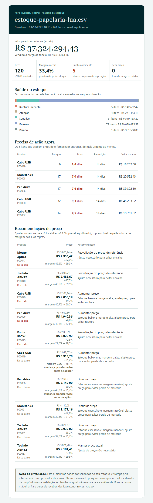

*O relatório gerado pelo `--dry-run` com a planilha sintética de 120 itens. O aviso de privacidade no rodapé diz, no próprio e-mail, por que ele chegou e como desligar.*

### 3.10 Front-end: FSD, SVG próprio e CSP sem `eval`

- **FSD** (`app / pages / widgets / entities / shared`) verificado pelo **Steiger** dentro do `npm run check`: slice usado por uma só página mora na página.
- **Gráficos em SVG próprio** (KPIs, régua de saúde, curva ABC): são geometria simples, testável como função pura (`graficos.ts`), sem biblioteca de terceiros; bundle leve.
- **Zod sem JIT** (`jitless`): o JIT usa `new Function`, e a CSP do app (`script-src 'self'`) bloqueia. O Chrome registrava a violação, o que foi corrigido em vez de afrouxar a CSP.
- **Radix avulso** (`react-dialog`, `react-tabs`) em chunk próprio e `sideEffects` declarado: carga inicial caiu de ≈ 144 para ≈ 125 KB gzip.
- **Teste de contrato com respostas reais do backend**: 16 respostas gravadas pelo backend real, e o front valida cada uma com Zod; se o backend mudar um campo, o teste do front quebra.
- **Estado do servidor** com TanStack Query (polling de 2 s da IA, invalidação ao salvar regras); roteamento por hash validado por regex (sem `react-router`: app local atrás do backend, sem servidor de fallback).
- **Acessibilidade**: primeiro `Tab` cai em "Pular para o conteúdo"; `Esc` fecha o diálogo e devolve o foco ao botão que o abriu; axe com 0 violações.

---

## 4. Como foi verificado

| Camada | Técnica | Escopo |
|---|---|---|
| Unidade e integração | pytest com `-W error::DeprecationWarning` | **488** testes no backend; 150 no front (Vitest) |
| Contrato | mesma suíte rodada em memória e SQLite | repositórios |
| Propriedade (fuzz com seed fixa) | invariantes independentes da implementação, com asserção de que os dois caminhos (aceito/recusado) foram exercitados | preço por margem (20 mil), guarda-corpo (20 mil), sugestão determinística (10 mil), sanitização idempotente (2 mil), upload (2 mil), ingestão (300 planilhas) |
| **Mutação** | plantar defeitos em pontos críticos e exigir que algum teste falhe | backend **43/43**; front **4/4** |
| Navegador real | Chrome com `puppeteer-core`, axe-core e Lighthouse | **26** verificações do cliente |
| Executável real | roteiro de ponta a ponta contra o `.exe` empacotado, CSV e XLSX, com e sem ofuscação | login, upload, mapeamento, painel, exclusão |
| OTA | dois `.exe`, HTTPS local com CA de teste, 4 cenários | seção 3.8.5 |
| Segredos | gitleaks no stage, na árvore versionada e no histórico | limpo, **sem allowlist** (fixture com cara de segredo foi trocada por valor obviamente falso) |

**O que a mutação pega que a cobertura não pega.** Exemplos de defeitos plantados: host externo aceito, guarda-corpo desligado, escape da tag desligado, limite de corpo desligado, contexto do blob não conferido, cabeçalhos removidos, neutralização de fórmula desligada, assinatura do token não verificada, SKU de volta ao prompt, hash do OTA não conferido, teto de download removido, replay aceito. Na primeira rodada do OTA, **4 mutantes sobreviveram**: um teste fraco de rota `/api` inexistente; a conferência de hash **mascarada** pela reconferência final; o teto de download **mascarado** pela checagem de tamanho; e um mutante com texto defasado. Os testes foram reforçados para exercitar cada defesa **sozinha**. São defeitos do tipo que a cobertura de linha não distingue: a linha executa, mas outra defesa mascara a falha.

---

## 5. Resultados medidos

Windows 10, Python 3.13, **dados sintéticos**. Uma execução cada, salvo onde indicado.

| Hipótese | Resultado |
|---|---|
| Mapeamento automático acerta formatos variados | **5/5** variantes (pt-BR com `;` e cp1252, inglês com BOM, pipe mínimo, só margem, `.xlsx`) |
| Preço fora do piso/teto | **0** em 20 mil casos aleatórios (guarda-corpo) e 10 mil (sugestão determinística) |
| `llama3.1:8b` devolve JSON válido | **sim**, 2/2 lotes nas três execuções reais (20 itens por lote). Amostra pequena |
| O modelo calcula preço de forma confiável | **não** (cortado 10/20 com preço absoluto); com ajuste percentual, 0 cortados em uma execução |
| Ingestão e indicadores | 200 mil linhas em **5,51 s**, pico de **580 MB** (seção 3.3) |
| Dado em repouso protegido | **sim**: nada em claro no SQLite nem no `-wal`; blob trocado de linha é recusado |
| Front | Lighthouse (build local, desktop/celular): login 100/98, painel 100/100; acessibilidade e boas práticas 100; SEO 54 **proposital** (`noindex`, app privado); LCP do painel 0,4 s/1,2 s; axe **0** violações em 12 telas/estados; ≈ **125 KB** gzip de carga inicial |
| Chrome real, cliente | **26/26**: login com erro uniforme, arrastar-e-soltar com `DragEvent` real, mapeamento, painel em 1280/768/360 px **sem rolagem horizontal**, IA local real pela interface, `Esc` e foco, regras, presets, console sem erros nem avisos |
| Executável real, CSV e XLSX, com e sem ofuscação | tudo ok nos dois builds; 78,2 MiB; partida ≈ 4 s |
| Ofuscação | PYZ: **267/267 → 0/267** nomes; **128/128 → 0/128** docstrings |
| OTA, E2E real | 4/4 cenários (seção 3.8.5); mutação **43/43** |

---

## 6. Erros que os meus próprios testes acharam

Documento isso porque é a evidência de que a verificação funciona e de que não escrevi o código perfeito de primeira.

| # | Erro | Como foi achado | Correção |
|---|---|---|---|
| 1 | Número com 500 dígitos estourava `decimal.InvalidOperation` em vez de virar erro de validação | fuzz | teste de regressão |
| 2 | Preset "agressivo" deixava o preço do excesso **maior** que o do "conservador" | teste de propriedade | preset redesenhado |
| 3 | SQLite em memória com `StaticPool` quebrava com várias threads | teste de concorrência | acesso serializado |
| 4 | O laço de lotes chamava `disjuntor.falha()` mesmo com o disjuntor já aberto (prolongava o bloqueio) | teste do disjuntor | o laço não registra falha quando o disjuntor já está aberto |
| 5 | Desenho do preço pela IA (preço absoluto) errava a escala | **teste real** com o modelo | ajuste percentual (D-017) |
| 6 | O build do cliente **ainda carregava o painel administrativo** | `verifica:sem-admin` | `import.meta.env` inlinado no ponto do `import()` |
| 7 | `<meta>` de CSP com `frame-ancestors` (ignorado e gerava erro no console) | Chrome real | o diretivo foi para o cabeçalho do backend |
| 8 | Foco **não** voltava ao botão depois do `Esc` no diálogo | roteiro de navegador | corrigido; meu teste de foco passava por engano (testava texto de `<main>`) |
| 9 | Violação de CSP por `eval` do Zod | console do Chrome | Zod `jitless` |
| 10 | **Minha medição de Lighthouse "desktop" mantinha o throttling de celular** | números bons demais | refeito com o preset oficial; os números do documento são os corretos |
| 11 | Dois mutantes sobreviveram porque meus testes passavam pelo motivo errado (token forjado expirava sozinho; "licença fora do modo comercial" usava um token que nem existia) | mutação | testes reescritos |
| 12 | O script de mutação regravava arquivos com CRLF no Windows e quebrou as próprias mutações seguintes | mutação | corrigido no próprio script |
| 13 | Planejei deixar a URL do OTA fora da assinatura | revisão ao implementar | a URL passou a ser assinada |
| 14 | `find`/`ping` do script de troca resolvidos pelo `PATH` (Git para Windows) | teste de espera | caminho absoluto de `System32` |
| 15 | Certificado de teste sem Authority Key Identifier recusado pelo Python 3.13 | E2E do OTA | o cliente fez certo; corrigi o gerador de CA de teste |
| 16 | gitleaks acusou fixtures com cara de segredo | scanner | fixture com valor obviamente falso; **sem allowlist** |
| 17 | Dois builds em segundo plano foram interrompidos e deixaram arquivo preso | build | builds longos em primeiro plano |

---

## 7. O que NÃO está provado

- **Banco e escala:** PostgreSQL real, qualquer carga HTTP, gravação cifrada de 200 mil itens, dashboard sobre 200 mil itens, tabela com milhares de páginas na interface. O dataset inteiro é recifrado a cada `salvar`; aceitável até dezenas de milhares de itens, **não medido** acima.
- **Plataformas:** só Windows 10 com Python 3.13; **não** rodou em Linux nem em CI. Só Chrome; sem leitor de tela real (NVDA/VoiceOver), celular físico, Firefox e Safari.
- **Qualidade do modelo.** As explicações do `llama3.1:8b` são **fracas e genéricas** na amostra (14 resumos distintos em 20) e **o texto pode contradizer a situação calculada** (recomendou "aumentar estoque" para itens com centenas de dias de cobertura). O preço segue protegido pelo guarda-corpo; o **texto não é validado** contra a situação. Se a qualidade for ruim, a saída é trocar o modelo por configuração, **nunca** afrouxar o guarda-corpo. Sem revisão por especialista de varejo.
- **Sem validação cruzada com o mercado.** Nenhuma comparação com ferramentas existentes. Estudo de engenharia e demonstração, não produto validado, sem cliente real e sem dado real: só planilhas sintéticas.
- **Segurança:** sem auditoria externa; a sanitização de PII é por expressões regulares (**nome próprio e endereço passam**, mitigado por mandar ao modelo só o necessário e o modelo ser local).
- **Licenciamento:** o executável **ainda não valida licença** contra um servidor remoto; pode ser copiado e usado sem token. Não há integração de pagamento.
- **OTA:** o manifesto **não tem validade** (um servidor comprometido pode reapresentar o manifesto atual para esconder uma versão nova: ataque de congelamento; só o downgrade é barrado); **não há rotação de chave** (perder a privada ou a senha encerra o OTA de todos os instalados; chave comprometida = atualização maliciosa assinável); sem reversão automática depois que a nova versão abre (fica o `.bak`); o script de troca recusa caminho de instalação com `" % & ^ | < > !`; upload em andamento não conta como "ocupado"; a URL do manifesto revela o IP ao host que a serve.
- **Executável:** sem Authenticode (SmartScreen e antivírus podem reclamar); o Ollama não vem dentro do executável (o cliente precisa instalá-lo e baixar o modelo); ofuscação é só atrito; DPAPI protege o arquivo parado, mas quem controla a conta do Windows abre tudo; não existe troca nem recuperação de senha do app (apagar o pacote de segredos deixa o banco ilegível).
- **E-mail de relatório:** testado só contra servidor SMTP falso, e o layout só no Chrome. Nenhum e-mail real foi enviado.
- **Estado em memória:** reiniciar o servidor no meio de uma análise de IA a perde (nada fica "em andamento" no banco).
- **Quantidade fracionária** (kg, litros) vai para a DLQ (limitação declarada, D-014).
- **Sem migração versionada:** o esquema é criado com `create_all`; mudança de esquema em produção exige migração.

---

## 8. Alternativas que descartei

| Alternativa | Por que não |
|---|---|
| Aceitar qualquer URL de IA (como no Kuro Core) | "o dado não sai" deixaria de ser verificável |
| Pedir preço absoluto ao modelo | medido: errou a escala e foi cortado em 10 de 20 |
| IA decide o mapeamento de colunas sozinha | trocar custo por preço é erro silencioso; confirmação humana obrigatória |
| Streaming para Parquet em disco | arquivo temporário em claro contradiz a criptografia obrigatória |
| `multipart/form-data` | o framework grava o upload em arquivo temporário em claro |
| `float` para dinheiro; margem como markup | erro de arredondamento; definição ambígua de margem |
| Cifra por coluna ou cifra de disco do SO | vazamento por índice; sem amarração do blob ao registro |
| Chave de criptografia em texto ao lado do banco | banco cifrado e chave lado a lado não protegem nada (DPAPI) |
| Cython | exige compilador C que não havia na máquina de build |
| Assinar só o hash do executável | não impede trocar o número da versão nem apontar a URL |
| RSA | mais parâmetros para errar, chave e assinatura maiores |
| Servidor que empurra atualização (push) | superfície de entrada na máquina do cliente |
| Chave privada do OTA em variável de ambiente | quem tem a privada assina qualquer atualização |
| Multi-tenant | um erro de consulta vaza dado entre clientes; single-tenant elimina a classe de erro |
| Biblioteca de gráficos / de animação | geometria simples e transições CSS bastam; bundle menor |
| `react-router` | app local sem servidor de fallback; roteamento por hash basta |
| Fila externa (Celery/RQ) para a análise de IA | uma instância local não precisa de broker; limite declarado |

---

## 9. Como repetir

No repositório privado (a vitrine não traz o código):

```
pytest                                   # 488 testes do backend
ruff check .
python scripts/mutacao.py                # mutação do backend (43)
cd frontend && npm run check             # formatação, lint, tipos, FSD, testes, build, verifica:sem-admin
python build_exe.py                      # front -> preparo -> PyArmor -> PyInstaller (ícone embutido)
python scripts/auditar_exe.py            # PYZ: nomes legíveis antes x depois
python scripts/e2e_exe.py --porta P --senha S   # ponta a ponta contra o .exe
python scripts/e2e_ota.py                # dois .exe, HTTPS local, 4 cenários
```

---

## Ficha técnica

Backend Python 3.13 · FastAPI 0.143 · Uvicorn · Pydantic v2 · Polars 2.0 + fastexcel (calamine) · SQLAlchemy 2.1 · `cryptography` (Fernet, Ed25519) · httpx · Ollama (`llama3.1:8b`) · PyInstaller 6 · PyArmor 9 · pytest (488). Front: Vite 8 · React 19 · TypeScript estrito · Tailwind v4 · Zod 4 · TanStack Query 5 · Radix escopado · FSD (Steiger) · Vitest. Dependências **fixadas** (`requirements.txt` e `requirements.lock`).

## Amostras (`amostras/`)

Trechos isolados, **sem imports do projeto**, que rodam sozinhos com `httpx`, `polars`, `fastexcel` e `cryptography` instalados. Nada de chave, token, segredo, caminho interno ou lógica administrativa. Foram exercitados por um roteiro próprio (45 verificações, incluindo 20 mil casos aleatórios do guarda-corpo e os 4 cenários do OTA).

| Arquivo | O que mostra | Seção |
|---|---|---|
| `ia_cliente_local.py` | host travado em localhost, sem proxy e sem redirect; retry com backoff; 4xx não repete | 3.1.1 |
| `ia_entrada_saida_hostil.py` | sanitização, dado embrulhado, validação item a item da resposta | 3.1.2, 3.1.3 |
| `ia_guarda_corpo_preco.py` | o modelo pede ajuste, o código calcula e corta em `[piso, teto]` | 3.1.4 |
| `dinheiro_centavos.py` | centavos inteiros, margem em pontos-base, parser BR/US | 3.2, 3.4 |
| `ia_disjuntor.py` | circuit breaker com meio-aberto, relógio injetável | 3.1.5 |
| `cofre_contexto.py` | Fernet/MultiFernet com blob amarrado ao registro | 3.6 |
| `ingestao_polars.py` | validação de upload, leitura para tabela de texto, perfil vetorizado | 3.3, 3.4 |
| `empacotamento_pyarmor.py` | variante gravada na compilação, chave pública embutida, PyArmor + PyInstaller | 3.7 |
| `ota_manifesto_ed25519.py` | bytes canônicos, validação estrita, verificação da assinatura | 3.8 |
| `ota_transporte_e_fluxo.py` | download com teto, HTTPS em cada redirect, fluxo em ordem de desconfiança | 3.8 |
